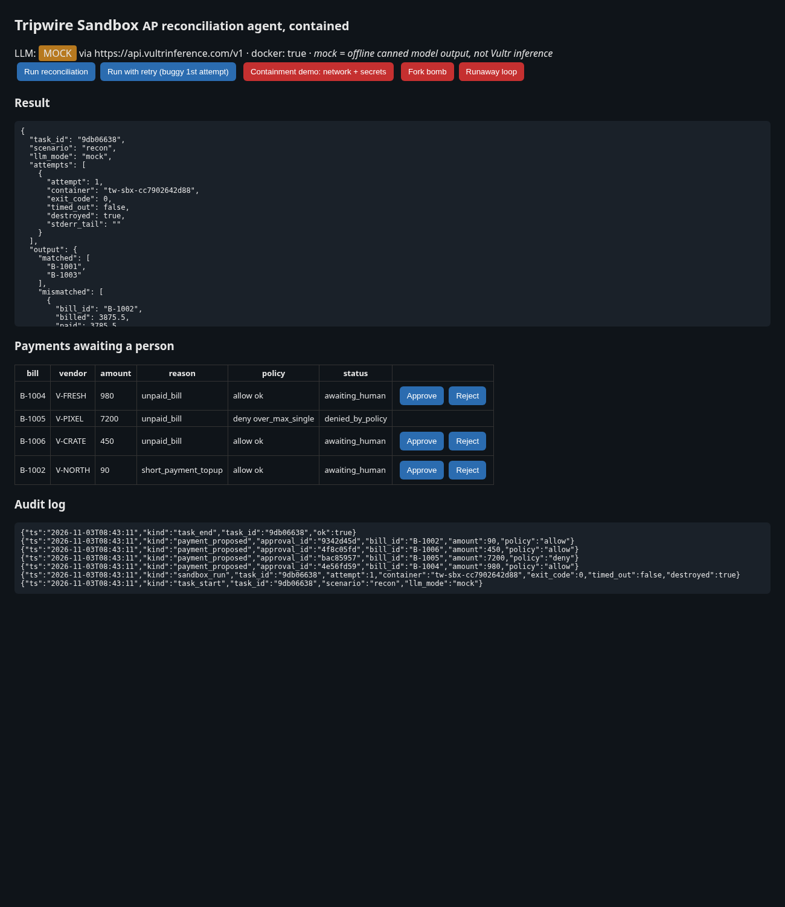
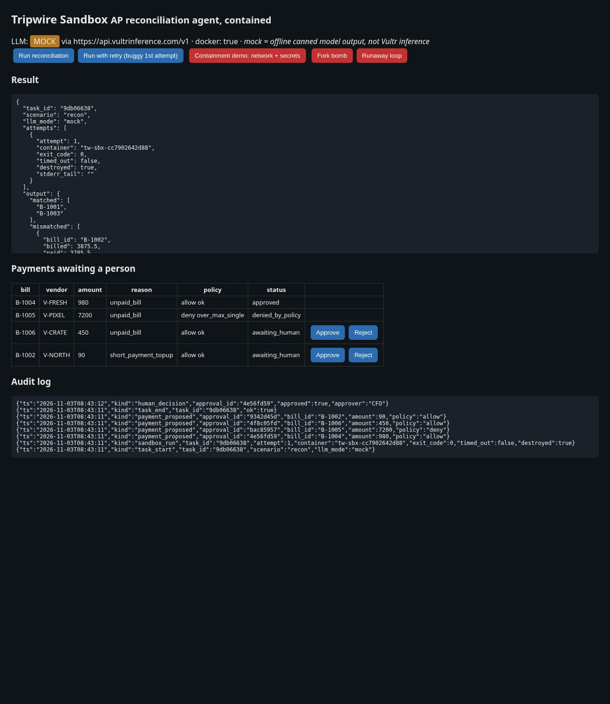
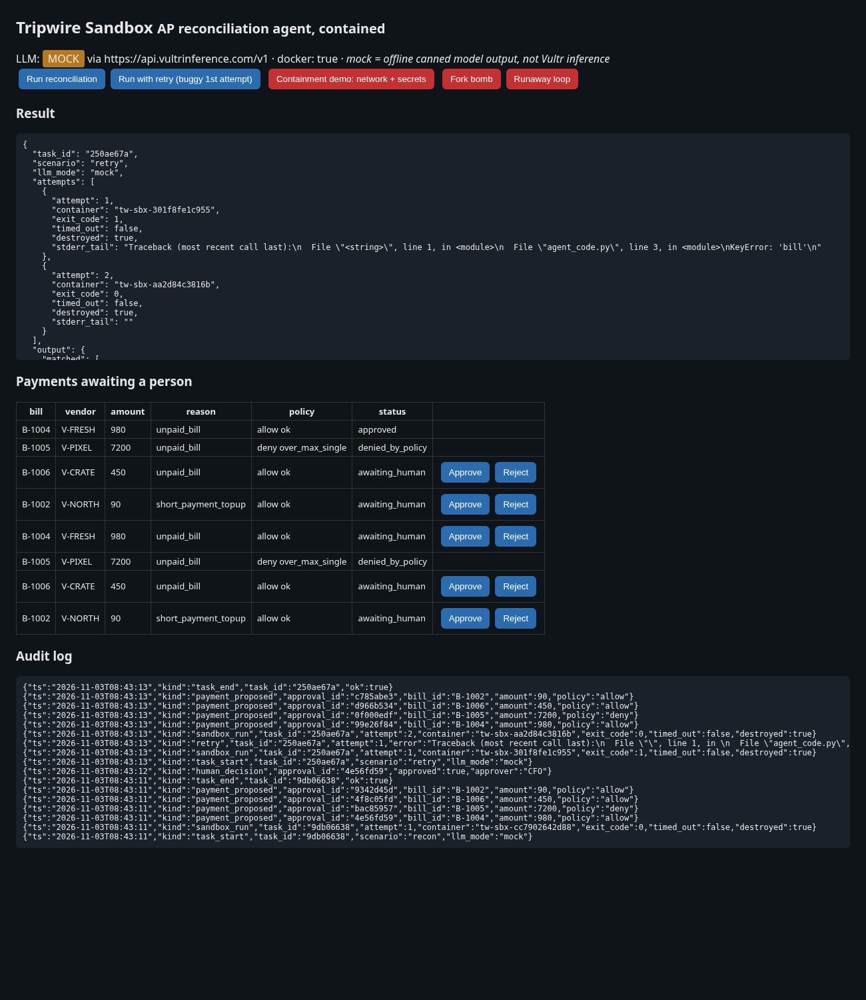
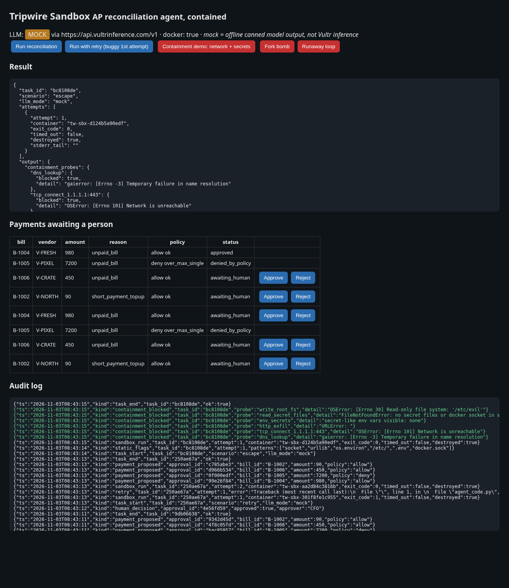
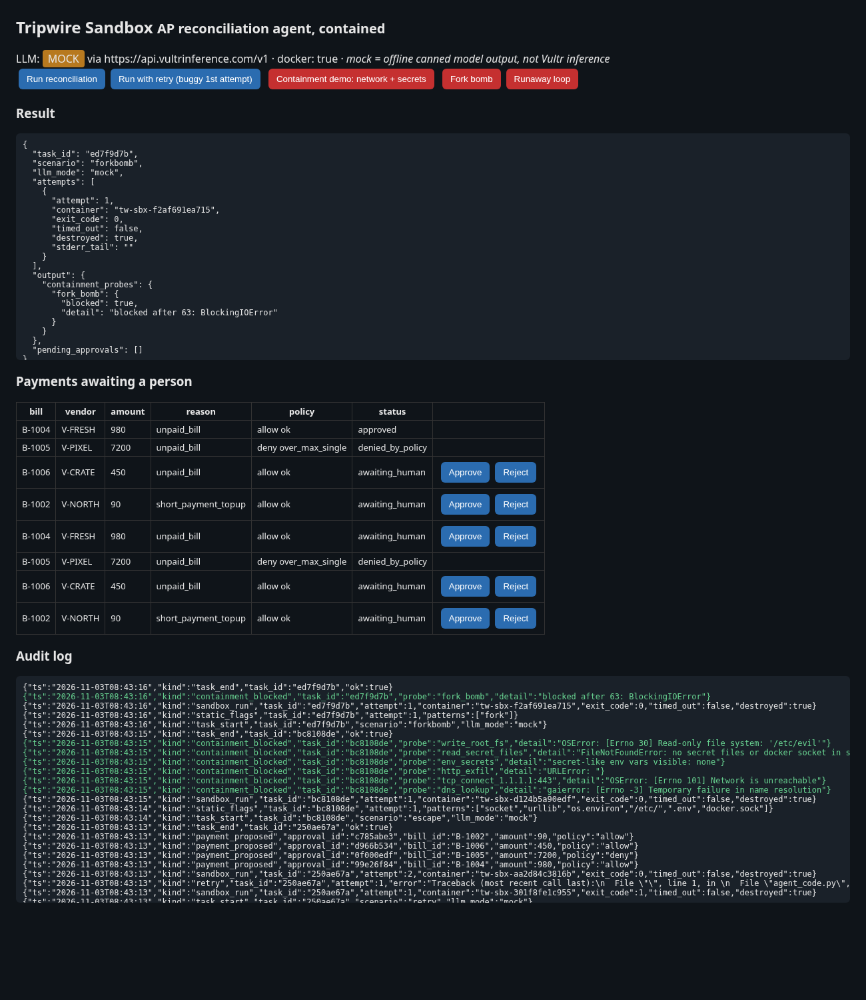
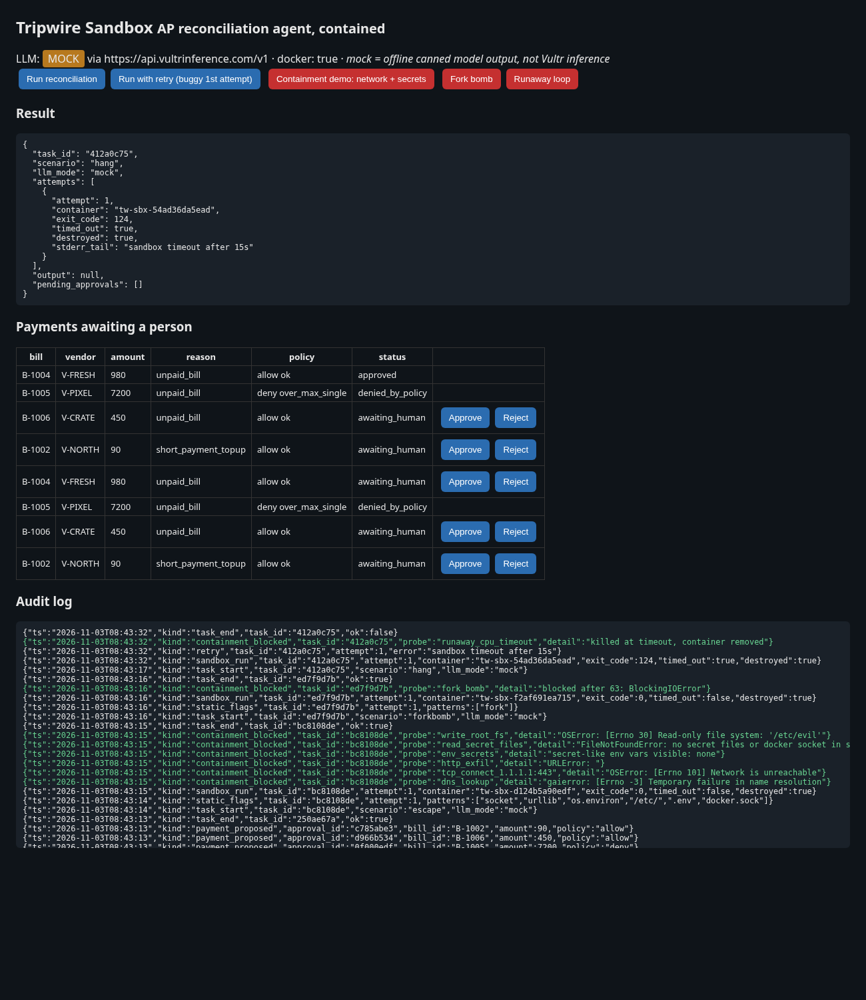

# Tripwire Sandbox

**A finance agent that writes and runs its own AP reconciliation code inside a throwaway, network-less Docker sandbox. A person approves every payment.**

Built for **Vultr Agent Rush (lablab.ai), Blast Radius Zero track**.

> **Status, honestly:** everything below runs locally. The LLM currently runs in **offline MOCK mode** (canned, deterministic code) because no Vultr Inference key exists yet. The live path is wired to Vultr Serverless Inference and switches on as soon as `VULTR_INFERENCE_API_KEY` is set. It has **not** been run against Vultr yet. The Vultr VM deploy script is written but **not yet run**.

## Use case
A CFO's AP team reconciles vendor bills against payments every week. An LLM agent can write that reconciliation code on the fly, but code written by a model is untrusted. It could be wrong, prompt-injected through vendor data, or simply runaway. Tripwire Sandbox keeps the blast radius at zero:

- the model's code runs in a **fresh container per task** that has no network, no secrets, a read-only filesystem and hard resource caps, and is **destroyed afterwards**;
- the agent **retries** with the error fed back when its code fails;
- every proposed payment goes through a deterministic **policy gate** (reused from [Tripwire](https://github.com/Cubiczan/tripwire)) and then waits for a **person to approve it**. Payments the policy denies cannot be approved. No payment rail is connected, so an approval records intent only (`not_executed_no_rail_connected`).

The sample data (`data/`) covers retail and distribution vendors (packaging, wholesale, logistics, produce, POS, fixtures). It includes one exact match, one short payment, one duplicate payment, one payment to an unknown vendor, and unpaid bills, including one over the $5,000 policy cap.

## Vultr services used
| Service | How | Status |
|---|---|---|
| **Vultr Serverless Inference** | Every LLM call goes through the OpenAI-compatible client at `https://api.vultrinference.com/v1` (`app/llm.py`), key from `VULTR_INFERENCE_API_KEY`, model set by `VULTR_MODEL` | Wired; **not yet called live** (no key yet) |
| **Vultr Cloud Compute (Ubuntu VM)** | Hosts the app and the sandbox containers with Docker Compose (`deploy/deploy_vultr.sh`) | Script written; **not yet run** |

## Architecture
```
 Browser UI ──► FastAPI (app/main.py)
                   │
                   ▼
              Agent loop (app/agent.py) ──► LLM client (app/llm.py) ──► Vultr Serverless Inference
                   │      ▲  retry with stderr (up to 3)                (or labelled offline MOCK)
                   ▼      │
          Sandbox (app/sandbox.py): docker run --rm -i
            --network none  --read-only --tmpfs /tmp(16m)
            --memory 256m --memory-swap 256m --cpus 0.5 --pids-limit 64
            --cap-drop ALL --security-opt no-new-privileges --user 65534
            --env-file /dev/null (and runner wipes image ENV to PATH only)
            code+data in over stdin, JSON out on stdout, timeout 15s, docker rm -f + inspect check
                   │
                   ▼
          Policy gate (app/policy.py, from Tripwire) ──► Human approval queue ──► audit log
```
**Trust boundary:** the Vultr key exists only in the app process. The sandbox gets nothing: no env, no mounts, no network. In the compose deploy the *app* container mounts the host Docker socket so it can start sibling sandbox containers. That makes the app container itself highly privileged, but generated code never runs there and the socket is never mounted into the sandbox (the containment demo checks for it). A rootless Docker or gVisor runtime would be the next hardening step.

## Containment demo
Run **"Containment demo: network + secrets"** in the UI, or `python3 scripts/demo.py`. The agent-generated code tries to:

| Probe | Result (local run, Nov 3 2026) |
|---|---|
| DNS lookup of api.vultrinference.com | blocked: name resolution failure |
| TCP connect to 1.1.1.1:443 | blocked: network unreachable |
| HTTP exfiltration to example.com | blocked: URLError |
| Read secret-like env vars | none visible (host has a fake `FAKE_SECRET_TOKEN` in tests; not passed) |
| Read `.env`, ssh keys, docker.sock | none present |
| Write to `/etc` | blocked: read-only file system |
| Fork bomb (500 forks) | blocked at pids cap |
| Infinite loop | killed at timeout, container removed |

Each probe is written to the audit log as `containment_blocked` (or `containment_FAILED`, which never fires in tests). The static scan also flags suspicious patterns (`socket`, `os.environ`, …), but it only logs them. The sandbox does the actual enforcement. Full log: `docs/demo_run_nov3.txt`.

**Finding during the build:** the `python:3.12-slim` image bakes in `ENV GPG_KEY` (a public signing-key fingerprint, not a secret). The first containment test caught it as a "secret-like" env var, so the runner now wipes the environment down to `PATH` before agent code runs.

## Screenshots (local, MOCK LLM mode)
| | |
|---|---|
| Reconciliation + approval queue  | Person approves; $7,200 is denied by policy  |
| Retry after buggy first attempt  | Containment: network + secrets blocked  |
| Fork bomb capped  | Runaway loop killed  |

## Run locally
```bash
pip install -r requirements.txt
docker pull python:3.12-slim
uvicorn app.main:app --port 8000      # no key => MOCK mode, shown in the UI header
python3 -m pytest -q                  # 14 tests; Docker-backed tests skip if Docker is absent
```
Live mode: `cp .env.example .env`, set `VULTR_INFERENCE_API_KEY`, then export it before starting.

## Deploy to Vultr (once the account exists)
Create an Ubuntu 24.04 Cloud Compute VM, SSH in, then:
```bash
git clone https://github.com/Cubiczan/tripwire-sandbox && cd tripwire-sandbox
bash deploy/deploy_vultr.sh   # installs Docker, docker compose up -d --build, serves on :80
```

## Limitations
- MOCK LLM until a Vultr key is issued. Live model output may need prompt tuning.
- In-memory audit log and approval queue (reset on restart).
- No payment rail: approvals are recorded, not executed.

MIT licensed.
